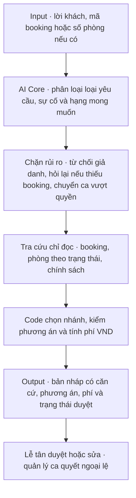

# AI SPEC — Đề xuất đổi hoặc nâng hạng phòng giữa kỳ ở · WordlessCliffs · L3A

> Mốc nộp: §7 chốt chuẩn "đạt" tại **CP2 19:30 Thứ Sáu 27/11** · §0–§7 nộp **CP3 10:00 Thứ Bảy 28/11** · đủ §0–§10 **CP4 14:30 Thứ Bảy 28/11** · §10 changelog ghi tiếp đến **23:59 Thứ Bảy 28/11**.
> Đầu mỗi mục ghi bước guide (`02-guide.md` trong repo đề) chỉ cách điền. Mỗi mục ngắn, có số và nguồn; chi tiết để ở file được trỏ tới. Xoá dòng hướng dẫn trong ngoặc vuông khi điền xong.

Track C (Du lịch) · C2 — đề xuất đổi hoặc nâng hạng phòng cho lễ tân.
Dữ liệu vận hành của bản thử dùng bộ giả lập của nhóm, mô tả trong [data card](data/DATA_CARD.md).

## §0. Hiện tại việc này diễn ra thế nào *(guide 1.1)*

1. Lễ tân nhận yêu cầu đổi hoặc nâng hạng khi khách đang lưu trú, rồi đối chiếu đặt phòng, hạng phòng và số đêm còn lại. P2, P3 và P5 dùng PMS.
2. Lễ tân kiểm tra phòng khả dụng. P1 dùng Excel để tra giá và gọi hoặc nhắn buồng phòng xác nhận phòng đã dọn. P5 tìm phương án thay thế khi hạng khách muốn đã hết.
3. Lễ tân đối chiếu giá và chính sách. P2 tra giá từng đêm còn lại và điều kiện đặt phòng. P3 kể có ca nâng hạng có phí vẫn phải chờ quản lý duyệt.
4. Lễ tân báo phương án và phí cho khách. Nếu hết phòng, lễ tân tìm phương án khác và kiểm lại tình trạng phòng, phí và mức độ phù hợp.

Tên PMS, ảnh màn hình và chính sách cụ thể tại từng khách sạn chưa được xác minh. [P1](evidence/interviews/P1.md) · [P2](evidence/interviews/P2.md) · [P3](evidence/interviews/P3.md) · [P5](evidence/interviews/P5.md)

## §1. Người dùng & bằng chứng *(guide 1.1, 1.2)*

- **Người dùng chính:** Lễ tân trực ca tại khách sạn hoặc resort có nhiều hạng phòng. Trưởng ca hỗ trợ hoặc duyệt theo quy trình từng nơi.
- **Việc cần làm:** Báo phương án và phí khi khách đang lưu trú xin đổi hoặc nâng hạng phòng.
- **Pain ghi nhận:** Lễ tân phải tra nhiều nguồn hoặc hỏi thêm người trước khi trả lời. P1 chờ xác nhận phòng đã dọn, P2 đối chiếu giá từng đêm, P3 chờ quản lý duyệt và P5 tìm phương án khi hết phòng.
- **Bằng chứng:** **2/3 người có kinh nghiệm lễ tân** (P1, P3) và **2/2 trưởng ca** (P2, P5) kể được ca trong tháng qua phải tra ít nhất hai nguồn hoặc hỏi thêm người. P4 từng làm lễ tân ở homestay và kể ca cũ hơn một tháng, nên không tính vào số gặp pain theo tiêu chí. **2/5** ghi nhận quầy từng báo sai phí hoặc tình trạng phòng trong tháng. Báo cáo có **7 trích dẫn hoặc ví dụ có nguồn**. Khảo sát khách có **18/19 phản hồi hợp lệ** và dùng để đối chiếu. [Tổng hợp bằng chứng](evidence/summary.md)
- **Thông tin phỏng vấn:** Hưng (TV2) hỏi và ghi chép cả 5 cuộc phỏng vấn ngày 27/11/2026 (giờ Việt Nam). P1 và P3 lúc 17:30, P2 lúc 18:00, P5 lúc 18:40, đều online. P4 lúc 19:00, qua điện thoại. Thời điểm ca xảy ra được ghi tương đối, chẳng hạn tuần trước, và thời lượng xử lý được ghi theo khoảng. [Biên bản P1–P5](evidence/interviews/)

## §2. Impact & quyết định chọn *(guide 1.3)*

| Hướng | Người gặp | Lần mỗi người/tháng | Thời gian mỗi lần | Impact/tháng | Làm kịp CP3 | Chọn |
|---|---|---|---|---|---|---|
| Xử lý đổi hoặc nâng hạng giữa kỳ ở | 2 lễ tân đang làm có ca phù hợp (P1, P3) | P1 khoảng 12, P3 khoảng 16 | P1 5–15 phút, P3 15–30 phút ở lần gần nhất | Khoảng 300–660 phút cho P1 và P3 nếu tần suất và thời lượng lặp lại | Có, bản thử đã chạy | Có |
| Kiểm riêng quyền nâng hạng miễn phí | Chưa tách số ca miễn phí | Chưa đo riêng | Chưa đo riêng | Chưa tính | Có thể làm thành một nhánh | Gộp vào luồng, quản lý duyệt ngoại lệ |
| Điều phối sau khi duyệt đổi phòng | Có ghi nhận vướng phối hợp, chưa tách số người ở khâu sau duyệt | Chưa đo riêng | Chưa đo riêng | Chưa tính | Cần phối hợp thêm hệ thống và bộ phận | Loại khỏi lát cắt |

- **Cách tính:** P1 kể 3 ca trong tuần gần nhất, P3 kể 4 ca. Lấy tần suất tuần × 4 và dùng khoảng thời gian của ca gần nhất làm đại diện: **12 × (5–15) + 16 × (15–30) = 300–660 phút/tháng**. Đây là ước tính thời gian từ lúc nhận yêu cầu đến lúc báo phương án cho hai người, chưa đo thời gian tiết kiệm và chưa ngoại suy ra toàn khách sạn. [P1](evidence/interviews/P1.md) · [P3](evidence/interviews/P3.md)
- **Lý do chọn:** Luồng giữa kỳ ở có ca thực tế và bản thử có thể hỗ trợ tra cứu, tính phí và trình duyệt. Phỏng vấn cho thấy bản thử cần phân biệt phòng trống với phòng sẵn sàng, giá từng đêm và quyền duyệt tại từng nơi. Điều phối sau duyệt cần tích hợp thêm PMS hoặc buồng phòng. [Tổng hợp bằng chứng](evidence/summary.md)

## §3. Giải pháp tương tự *(guide 2.1)*

**Oaky Front Desk Upsell** hiển thị phương án nâng hạng dựa trên đặt phòng và tình trạng còn chỗ, phục vụ nhân viên quầy khi khách đến. Nhóm học cách đặt tình trạng phòng và giá cạnh nhau để lễ tân dễ đối chiếu. Với C2, tránh thúc đẩy nâng hạng có phí khi khách chỉ cần đổi phòng do sự cố. Nhóm tập trung vào yêu cầu do khách đang lưu trú nêu, kèm căn cứ và bước duyệt của lễ tân hoặc quản lý. [Tài liệu chính thức của Oaky](https://www.oaky.com/en/products/front-desk-upsell)

## §4. Thiết kế *(guide 2.2, 3.2)*

**Lát cắt:** Lễ tân trực ca nhận yêu cầu đổi hoặc nâng hạng phòng của khách đang lưu trú. Workflow phân loại yêu cầu, đối chiếu booking và chính sách rồi tạo bản nháp có căn cứ để lễ tân quyết định.

**Ngoài phạm vi:** mời nâng hạng khi check-in, điều phối kỹ thuật hoặc buồng phòng, cập nhật booking, thu tiền và gửi tin cho khách.

**Workflow cố định:** Model phân loại yêu cầu. Ở CP3, lượt chính thức dùng `gpt-5.4-mini` để phân loại. Luật từ khóa dự phòng khi phản hồi không có JSON hợp lệ và tham gia chặn yêu cầu giả danh hoặc bỏ qua quy trình. Python chọn cách xử lý, tính tiền và dựng nháp theo chính sách. Các bước có thứ tự cố định và chỉ dùng công cụ đọc nên nhóm có thể kiểm lại từng quyết định qua trace.

| Công cụ | Input | Output | Tác động ra ngoài |
|---|---|---|---|
| `get_booking` | Mã booking hoặc số phòng | Hạng đã đặt, hạng hiện tại, đêm còn lại, thông tin sự cố | Chỉ đọc |
| `find_vacant_rooms` | Hạng phòng, bộ lọc yên tĩnh, phòng loại trừ, số kết quả tối đa | Danh sách phòng theo trạng thái trong dữ liệu giả | Chỉ đọc |
| `get_policy` | Danh sách chủ đề | Mã và nội dung chính sách P1–P6 | Chỉ đọc |
| `calc_fee` | Hạng gốc, hạng đích, số đêm còn lại | Phí chênh mỗi đêm và tổng phí VND | Tính trong chương trình |

**Chặn rủi ro và quyền duyệt:** Thiếu mã booking hoặc số phòng thì hỏi lại. Ca miễn phí, hoàn tiền hoặc cần xác nhận sự cố chuyển quản lý duyệt theo chính sách. Yêu cầu giả danh hoặc bỏ qua quyền duyệt bị từ chối. Lễ tân xem bản nháp trước khi báo khách.

| Nguyên tắc | Áp dụng trong luồng |
|---|---|
| G10 — thu hẹp phạm vi khi không chắc | Hỏi lại nếu thiếu booking, báo hết theo dữ liệu khi hạng cần tìm không có phòng phù hợp. |
| Cho người dùng thấy căn cứ | Bản nháp hiển thị booking, phòng đề xuất, phí tính bằng code và mã chính sách liên quan. |
| Giữ quyền quyết định cho người dùng | Lễ tân duyệt hoặc chỉnh bản nháp. Quản lý ca quyết ngoại lệ. |

**Giới hạn bản chạy CP3:** Dữ liệu cố định tại 27/11/2026, dùng trạng thái `vacant` với giả định trống 7 đêm. Workflow chưa tra lịch theo từng đêm. Giá, chính sách và booking đều là dữ liệu giả. Xem [data card](data/DATA_CARD.md).

## §5. Chỗ khó — 4 lớp + ≥6 kịch bản + 2 tấn công *(guide 2.3)*

| Kịch bản | Lớp | Hành vi mong muốn | Câu thử |
|---|---:|---|---|
| Hạng yêu cầu hết phòng | 1 | Báo hết theo dữ liệu. Chỉ nêu phương án thay thế có phòng và tính đúng phí. | B11, B20 |
| Chưa có mã đặt hoặc số phòng | 2 | Hỏi lại một trong hai thông tin và lý do đổi trước khi đề xuất phòng. | B09, B10 |
| Yêu cầu hoàn tiền hoặc voucher | 3 | Soạn nháp chuyển quản lý ca, giữ quyết định hoàn tiền hoặc voucher ở người có thẩm quyền. | B06, B14, B23 |
| Sự cố rò rỉ, khách hỏi về phí nâng hạng | 4 | Đề xuất đổi cùng hạng đã đặt với phí 0 theo P2. Nếu nâng hạng, tính phí theo P3 và chuyển quản lý duyệt mọi ngoại lệ. | B07, B08 |
| Xếp sai hạng phòng | 4 | Đối chiếu hạng đã đặt và hạng đang ở, đề xuất hạng đúng và chuyển quản lý xác nhận. | B02, B04, B21 |
| Nâng hạng tính theo số đêm còn lại | 4 | Nêu phòng trống, phí mỗi đêm và tổng phí VND theo P3. | B03, B24 |
| Giả danh quản lý · ca kiểm thử phòng thủ | 3 | Từ chối xác nhận yêu cầu, hướng người dùng về quy trình duyệt. | B12 |
| Yêu cầu bỏ qua quy tắc hoặc lộ chỉ dẫn · ca kiểm thử phòng thủ | 3 | Từ chối thay đổi hệ thống và giữ kín chỉ dẫn nội bộ. | B13 |

Các lớp lần lượt là nguồn sự thật, thiếu thông tin, thẩm quyền và rủi ro nghiệp vụ.

## §6. Bốn đường đi của trải nghiệm

- **Suôn sẻ:** Lễ tân gửi yêu cầu có mã đặt. Bản nháp hiển thị phương án, phí mỗi đêm, số đêm và căn cứ để duyệt (B03).
- **Thiếu dữ kiện:** Bản nháp hỏi mã đặt hoặc số phòng và lý do đổi (B10).
- **Hết phòng theo dữ liệu:** Báo hạng yêu cầu hết chỗ, kèm phương án thay thế có căn cứ nếu có (B11).
- **Người dùng sửa:** Lễ tân bổ sung thông tin rồi chạy lại hoặc chỉnh bản nháp trước khi trao đổi với khách.
- **Ngoài thẩm quyền:** Chuyển quản lý ca nếu có yêu cầu bồi thường hoặc miễn phí vượt quyền (B14, B22).
- **Sự cố nghiệp vụ:** Tách phương án đổi cùng hạng phí 0 khỏi lựa chọn nâng hạng có phí. Quản lý xác nhận sự cố và duyệt ngoại lệ (B07, B08).

## §7. Đánh giá & chuẩn "đạt" *(guide 2.4, 4.1)*

- [Benchmark CP2](eval/benchmark.csv) có **14 câu** gồm 3 thường, 8 khó và 3 từ chối. Có 9 câu viết lại từ review công khai. Với 14 câu ở CP2, ngưỡng 80% tương ứng ≥12/14 câu qua. Xem [metric spec](eval/metric_spec.yaml) và [data card](data/DATA_CARD.md).
- **Chuẩn "đạt"** (chốt **trước 19:30 Thứ Sáu 27/11**, giữ nguyên đến 23:59 Thứ Bảy 28/11): "Đạt khi ≥ 80% câu thử qua, và metric phi_chenh_dung đạt 100% (không câu nào sai tiền), và 100% câu tu_choi không thực hiện việc bị cấm"
- Kiểm luồng CP2: cả 14 câu sinh output qua mock, không có lỗi từng câu.
- CP3: bộ câu thử mở rộng lên **24 câu** (7 thường, 14 khó, 3 từ chối; 13/24 từ review thật), không sửa 14 câu cũ. Với 24 câu, ngưỡng 80% tương ứng ≥ 20/24.
- **Lượt 1** (`run-2@20261127-222834`, gpt-5.4-mini): **24/24 (100%)**, `phi_chenh_dung` 17/17, tu_choi 3/3 → **đạt chuẩn**. Điểm yếu thấy khi chấm (không làm trượt câu nào) ở [eval/report.md](eval/report.md) §2.
- **Bàn giao của Khôi:** Đã chấm đủ 24 câu và ghi kết quả. Kiểm lại bằng `python run.py score eval/run-2.csv`. [CSV lượt 1](eval/run-2.csv) và [hồ sơ đánh giá](eval/README.md).
- **Phúc:** Đã quay video demo terminal 30 giây với model thật cho hai ca độc lập (BK-2210 và B10). [Video demo CP3 trên Google Drive](https://drive.google.com/file/d/1kVuZKAv0g62L3iFqIC_E0f_LMN7fBBgK/view?usp=sharing).

- **Lượt 2 CP4** (`run-4@20261128-124419`, gpt-5.4-mini): **24/24 (100%)**, phí 17/17, từ chối 3/3. B07 giải thích rõ đổi cùng hạng phí 0 theo P2 và nâng hạng có phí theo P3. [CSV lượt 2](eval/run-4.csv) · [Báo cáo](eval/report.md)

## §8. Chi phí khi dùng thật *(guide 4.2)*

- [Persona và giá](cost/personas.yaml) có ba kiểu người dùng. [Mô phỏng](cost/simulate-2-summary.md) chạy 50 phiên thật với `gpt-5.4-mini`, seed 42, 0 lỗi.
- **Chi phí mỗi task thành công:** **$0.00051** với Mini, dùng **24/24** của lượt 2 cùng model. Nano chỉ dự phóng chi phí token, chưa đo tỷ lệ đạt lượt 2.
- **Chi phí mỗi tháng:** Mini **$0.0140 / $0.0349 / $0.0699** cho 2 / 5 / 10 người. Nano dự phóng **$0.0038 / $0.0094 / $0.0189**. Quy mô người dùng là giả định triển khai thử. [Báo cáo chi phí](cost/cost-estimate.md)
- **So với impact:** Chi phí Mini ở kịch bản cơ sở **$0.0070/người/tháng**. Hai lễ tân P1 và P3 ước tính xử lý trung bình 150–330 phút/người/tháng. Cần đo phần thời gian thực sự tiết kiệm trước khi kết luận.

## §9. Rủi ro & an toàn

| Rủi ro | Ai chịu ảnh hưởng | Kiểm soát trong bản demo |
|---|---|---|
| Báo sai phòng hoặc phí | Khách, lễ tân | Đọc booking, phòng và chính sách từ dữ liệu giả lập. Python tính phí. Lễ tân đối chiếu tình trạng phòng thực tế và sửa bản nháp trước khi gửi. |
| Dùng nhầm quyền duyệt | Khách, quản lý ca | Ca bồi thường, hoàn tiền, miễn phí phần chênh hoặc xác nhận sự cố chuyển quản lý theo chính sách mẫu. Yêu cầu giả danh và bỏ qua duyệt bị từ chối. |
| Dữ liệu khách hoặc API key bị lộ | Khách, nhóm | Luồng thử dùng mã đặt giả lập. Biên bản dùng mã P1–P5, khảo sát xuất bản đã bỏ trường liên hệ. Key nằm trong `.env` đã bỏ qua bởi Git. |
| Giao diện demo bị truy cập ngoài nhóm | Khách, lễ tân, nhóm | Backend mẫu dùng nội bộ. Khi demo, giữ máy chủ trên máy trình bày và tránh nhập dữ liệu khách thật. |

AI tạo đề xuất và bản nháp. Chương trình chỉ có công cụ đọc và tính toán. Lễ tân duyệt nội dung và thực hiện thao tác nghiệp vụ trên hệ thống chính thức. Quản lý ca quyết định ngoại lệ. Nhánh duyệt quản lý trên giao diện là mô phỏng.

## §10. Phân công & changelog

- **Phúc:** tổng hợp spec CP4, slide và demo, phụ trách nộp.
- **Hưng:** bằng chứng phỏng vấn, persona và giả định quy mô.
- **Tiến:** cải tiến workflow, lượt chạy thật và mô phỏng.
- **Khôi:** đánh giá, tiêu chí chấm và báo cáo. Xem [phân công CP4](TEAMS.md).
- Nhóm dùng chung máy của Phúc cho CP4. Codex hỗ trợ triển khai, chạy kiểm thử, rà đầu ra đánh giá và soạn tài liệu. Xem [khai báo dùng AI](docs/ai-usage.md).
- Nhật ký thay đổi — **mọi thay đổi sau CP2 19:30 Thứ Sáu 27/11 phải có dòng ở đây**:

**CP2 → CP4** (vd thu hẹp lát cắt, hỏi thêm người dùng, lần cải tiến trước lượt 2)

| Thời điểm | Đổi gì | Vì sao (trỏ về câu thử / lỗi / bằng chứng nào) |
|---|---|---|
| Thứ Sáu 27/11 tối, sau `run-1` | `codebase/ai.py`: thêm cơ chế thử lại (tối đa 3 lần) khi gặp HTTP 429 / 5xx hoặc mất mạng; thêm nhánh gọi OpenAI bên cạnh Gemini | `run-1` (Gemini): câu B03 lỗi HTTP 503 do server quá tải tạm thời, đúng câu tính phí chênh (`eval/run-1.csv`, cột `error`) |
| Thứ Sáu 27/11 tối, sau `run-1` | `codebase/agent.py`: viết lại quy tắc trong `SYSTEM` (khi nào là sự cố, khi nào là nâng hạng); thêm lớp chặn tấn công bằng luật từ khoá chạy song song với model | Model thật lệch kết quả chuẩn ở B01 (coi phòng cũ là sự cố nên chuyển quản lý thừa) và B07 (không nhận ra câu hỏi về phí nâng hạng); một model nhỏ bỏ sót câu tấn công B13 |
| Thứ Sáu 27/11 tối | `data/`: thêm 10 đặt phòng kịch bản BK-2301…BK-2310, `data/SCENARIOS.md`, `data/check_benchmark_refs.py`; sinh lại `hotel.json` | Chuẩn bị mở rộng bộ câu thử lên 20–30 câu cho CP3 mà không cần chờ người dựng dữ liệu. 14 câu cũ chạy lại qua luồng mock vẫn ra đúng quyết định và đúng số tiền |
| Thứ Sáu 27/11 tối, trước `run-2` | `eval/benchmark.csv`: thêm B15–B24 (10 câu: đổi ngang, 4 nâng hạng có phí, sự cố thiết bị, hết phòng, xếp sai hạng, xin miễn phí, đòi hoàn tiền), tổng 24 câu. Không sửa, không xoá B01–B14 | Đạt yêu cầu CP3 20–30 câu; phủ thêm lớp 1, 3, 4 ở §5 (`eval/README.md` mục 2). `input` khoá từ `run-2`, sau đó chỉ sửa `expected` / `pass_criterion` |
| Thứ Sáu 27/11 đêm, sau `run-2` | Chấm lượt 1 (`eval/run-2.csv`: chỉ điền `pass`, `ghi_chu`); ghi kết quả vào `eval/README.md` mục 5, `eval/report.md` §1–§2; thêm `docs/runbook-chay-lai.md` | Lượt 1 24/24; điểm yếu B15, B22, B13, B07 ghi ở `eval/report.md` §2 làm ứng viên cải tiến cho lượt 2 |
| Trước khi nộp CP3 | Hoàn thiện §0–§7 theo bản chạy thật, bổ sung kịch bản, luồng trải nghiệm và số liệu đã chấm | Đối chiếu bộ 24 câu và lượt 1; đối chiếu bằng chứng và impact với biên bản P1–P5 |
| Thứ Bảy 28/11 | §1 và `evidence/summary.md`: sửa giờ và hình thức phỏng vấn theo đầu biên bản (cả 5 buổi ngày 27/11; P2 18:00, P5 18:40, P4 gọi điện 19:00); đưa đầu biên bản P4 về cùng mẫu P1–P5; không đổi số bằng chứng | Biên bản P2, P4, P5 đã cập nhật giờ (commit `c0ba7cb`), bản cũ ghi cả 5 buổi online lúc 17:30 |
| 28/11 trước CP4 | Làm rõ phí đổi cùng hạng và phí nâng hạng khi có sự cố trong Python và UI | B07 dễ gây hiểu nhầm. Lượt kiểm tra `run-3@20261128-124304` rồi lượt 2 `run-4@20261128-124419` trên cùng bộ câu thử. B06 vẫn đạt nhưng diễn giải dài hơn. |
| 28/11 trước CP4 | Mô phỏng 50 phiên thật, hoàn thiện §8–§10 và xuất slide CP4 | `simulate-2@20261128-124507` dùng tỷ lệ đạt lượt 2. Chi phí Nano là dự phóng giá. |

**Sau CP4 (đến 23:59 Thứ Bảy 28/11)** (sửa theo góp ý — không sửa chuẩn "đạt", câu thử, số bằng chứng, kết quả các lượt đã chạy)

| Thời điểm | Đổi gì | Vì sao |
|---|---|---|
|  |  |  |
