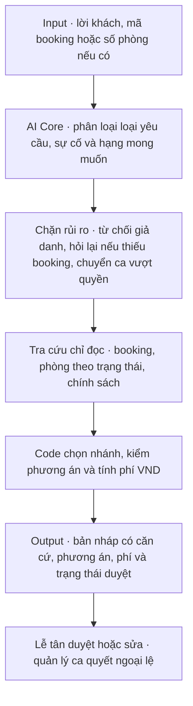

# AI SPEC — Đề xuất đổi hoặc nâng hạng phòng giữa kỳ ở · WordlessCliffs · L3A

> Mốc nộp: §7 chốt chuẩn "đạt" tại **CP2 19:30 Thứ Sáu 27/11** · §0–§7 nộp **CP3 10:00 Thứ Bảy 28/11** · đủ §0–§10 **CP4 14:30 Thứ Bảy 28/11** · §10 changelog ghi tiếp đến **23:59 Thứ Bảy 28/11**.
> Đầu mỗi mục ghi bước guide (`02-guide.md` trong repo đề) chỉ cách điền. Mỗi mục ngắn, có số và nguồn; chi tiết để ở file được trỏ tới. Xoá dòng hướng dẫn trong ngoặc vuông khi điền xong.

Track C (Du lịch) · C2 — đề xuất đổi hoặc nâng hạng phòng cho lễ tân.
Dữ liệu vận hành của bản thử dùng bộ giả lập của nhóm, mô tả trong [data card](data/DATA_CARD.md).

## §0. Hiện tại việc này diễn ra thế nào *(guide 1.1)*
- Luồng hiện tại của việc này, trong khoá hoặc trên app thật (3–5 bước; ảnh chụp từ tài khoản của mình, đã che thông tin):
- Công cụ / AI đang được dùng cho việc này (nếu có) + nguồn. Không kiểm được thì ghi "chưa kiểm":

## §1. Người dùng & bằng chứng *(guide 1.1, 1.2)*
- Người dùng chính (một vai cụ thể):
- Việc họ cố làm xong (`động từ + đối tượng + bối cảnh`, không có chữ AI):
- Hôm nay họ giải bằng gì, hỏng ở đâu, vì sao chưa bỏ:
- Pain (KHÔNG chữ AI): ai — đang làm gì — vướng đâu — hậu quả gì:
- Bằng chứng: đang phỏng vấn 1 lễ tân. Kết quả và trích dẫn thực địa sẽ ghi trong [tổng hợp bằng chứng](evidence/summary.md) khi có ghi chép.

## §2. Impact & quyết định chọn *(guide 1.3)*

| Hướng | Bao nhiêu người gặp | Bao nhiêu lần / tháng | Mỗi lần tốn gì | Impact / tháng | Làm kịp không | Chọn? |
|---|---|---|---|---|---|---|
|  |  |  |  |  |  |  |
|  |  |  |  |  |  |  |
|  |  |  |  |  |  |  |

- **Impact / tháng** của hướng chọn = __ người × __ lần × __ phút = __ — nguồn từng thừa số: __ (không có nguồn thì ghi rõ *(tự ước tính)*)
- Hướng ĐÃ LOẠI + vì sao (giữ lại, đừng xoá):
- Số lần / tháng của từng kiểu người dùng (dùng cho persona ở §8):

## §3. Giải pháp tương tự *(guide 2.1)*
- [sản phẩm / tính năng gần giống]: một điều đáng học · một điều đáng né · mình khác gì

## §4. Thiết kế *(guide 2.2, 3.2)*

**Lát cắt:** Lễ tân trực ca nhận yêu cầu đổi hoặc nâng hạng phòng của khách đang lưu trú. Workflow phân loại yêu cầu, đối chiếu booking và chính sách rồi tạo bản nháp có căn cứ để lễ tân quyết định.

**Ngoài phạm vi:** mời nâng hạng khi check-in, điều phối kỹ thuật hoặc buồng phòng, cập nhật booking, thu tiền và gửi tin cho khách.

**Workflow cố định:** Model phân loại yêu cầu. Ở CP2, model giả trả lời mẫu và chương trình dùng luật từ khóa dự phòng. Python chọn cách xử lý, tính tiền và dựng nháp theo chính sách. Các bước có thứ tự cố định và chỉ dùng công cụ đọc nên nhóm có thể kiểm lại từng quyết định qua trace.

| Công cụ | Input | Output | Tác động ra ngoài |
|---|---|---|---|
| `get_booking` | Mã booking hoặc số phòng | Hạng đã đặt, hạng hiện tại, đêm còn lại, thông tin sự cố | Chỉ đọc |
| `find_vacant_rooms` | Hạng phòng, bộ lọc yên tĩnh, phòng loại trừ, số kết quả tối đa | Danh sách phòng theo trạng thái trong dữ liệu giả | Chỉ đọc |
| `get_policy` | Danh sách chủ đề | Mã và nội dung chính sách P1–P6 | Chỉ đọc |
| `calc_fee` | Hạng gốc, hạng đích, số đêm còn lại | Phí chênh mỗi đêm và tổng phí VND | Tính trong chương trình |

**Chặn rủi ro và quyền duyệt:** Thiếu mã booking hoặc số phòng thì hỏi lại. Ca miễn phí, hoàn tiền hoặc cần xác nhận sự cố chuyển quản lý duyệt theo chính sách. Yêu cầu giả danh hoặc bỏ qua quyền duyệt bị từ chối. Lễ tân xem bản nháp trước khi báo khách.

| Nguyên tắc | Áp dụng trong luồng |
|---|---|
| G10 — thu hẹp phạm vi khi không chắc | Hỏi lại nếu thiếu booking, báo hết theo dữ liệu khi hạng cần tìm không có phòng phù hợp. |
| Cho người dùng thấy căn cứ | Bản nháp hiển thị booking, phòng đề xuất, phí tính bằng code và mã chính sách liên quan. |
| Giữ quyền quyết định cho người dùng | Lễ tân duyệt hoặc chỉnh bản nháp. Quản lý ca quyết ngoại lệ. |

**Giới hạn CP2:** Dữ liệu cố định tại 27/11/2026, dùng trạng thái `vacant` với giả định trống 7 đêm. Workflow chưa tra lịch theo từng đêm. Giá, chính sách và booking đều là dữ liệu giả. Xem [data card](data/DATA_CARD.md).

## §5. Chỗ khó — 4 lớp + ≥6 kịch bản + 2 tấn công *(guide 2.3)*

| Kịch bản | Lớp (1–4) | Hành vi mong muốn (nói gì, hiện gì, cho làm gì tiếp) | Câu thử |
|---|---|---|---|
|  |  |  |  |
| *(tấn công)* |  |  |  |
| *(tấn công)* |  |  |  |

(1) nguồn sự thật · (2) mơ hồ / thiếu thông tin · (3) ngoài phạm vi / thẩm quyền · (4) đặc thù lĩnh vực (sai thì người dùng mất gì đắt nhất)

## §6. Bốn đường đi của trải nghiệm
- Mọi thứ suôn sẻ: · Không chắc (lớp 2): · Không có căn cứ (lớp 1): · Người dùng sửa:
- Bị đòi ngoài phạm vi (lớp 3): · Trường hợp đặc thù lĩnh vực (lớp 4):

## §7. Đánh giá & chuẩn "đạt" *(guide 2.4, 4.1)*

- [Benchmark CP2](eval/benchmark.csv) có **14 câu** gồm 3 thường, 8 khó và 3 từ chối. Có 9 câu viết lại từ review công khai. Với 14 câu ở CP2, ngưỡng 80% tương ứng ≥12/14 câu qua. Xem [metric spec](eval/metric_spec.yaml) và [data card](data/DATA_CARD.md).
- **Chuẩn "đạt"** (chốt **trước 19:30 Thứ Sáu 27/11**, giữ nguyên đến 23:59 Thứ Bảy 28/11): "Đạt khi ≥ 80% câu thử qua, và metric phi_chenh_dung đạt 100% (không câu nào sai tiền), và 100% câu tu_choi không thực hiện việc bị cấm"
- Kiểm luồng CP2: cả 14 câu sinh output qua mock, không có lỗi từng câu. Tỉ lệ đạt lượt 1 và lượt 2 sẽ ghi sau khi chạy model thật và chấm theo benchmark.

## §8. Chi phí khi dùng thật *(guide 4.2)*
- Persona + giá: `cost/personas.yaml` · lượt mô phỏng: `cost/simulate-__.csv` (__ phiên)
- Chi phí / task thành công: __ (model __) · __ (model __)
- Chi phí / tháng ở quy mô thật: thấp __ · cơ sở __ · cao __ → chi tiết `cost/cost-estimate.md`
- So với impact / người / tháng (§2): đáng làm không, vì sao:

## §9. Rủi ro & an toàn
- Dữ liệu: đã ẩn danh gì, không thu gì, không đưa gì vào model gói miễn phí:
- AI **không được** làm gì kể cả khi người dùng yêu cầu:
- Ai có thể bị hại nếu AI sai, và nhóm chặn thế nào:

## §10. Phân công & changelog
- **Đồng Ngọc Phúc:** chốt lát cắt, cập nhật canvas, viết §4 và §7, tổng hợp và nộp CP2.
- **Nguyễn Việt Hưng:** phỏng vấn, tổng hợp bằng chứng pain và bàn giao tình huống cho Khôi.
- **Nguyễn Trần Tiến:** dựng dữ liệu giả lập, viết data card và triển khai workflow mock.
- **Nguyễn Trần Anh Khôi:** viết benchmark, metric, cùng Tiến kiểm luồng và cùng Phúc đối chiếu chuẩn đạt.
- Cặp phối hợp CP2: Tiến–Khôi thống nhất dữ liệu đầu vào và kết quả mong đợi. Phúc–Hưng cập nhật canvas theo bằng chứng có nguồn.
- Dùng Codex để rà repo, xử lý dấu xung đột trong canvas và soạn §4, §7. Nhóm rà lại luồng, dữ liệu và tiêu chí chấm trước khi nộp. Xem [khai báo dùng AI](docs/ai-usage.md).
- Nhật ký thay đổi — **mọi thay đổi sau CP2 19:30 Thứ Sáu 27/11 phải có dòng ở đây**:

**CP2 → CP4** (vd thu hẹp lát cắt, hỏi thêm người dùng, lần cải tiến trước lượt 2)

| Thời điểm | Đổi gì | Vì sao (trỏ về câu thử / lỗi / bằng chứng nào) |
|---|---|---|
|  |  |  |

**Sau CP4 (đến 23:59 Thứ Bảy 28/11)** (sửa theo góp ý — không sửa chuẩn "đạt", câu thử, số bằng chứng, kết quả các lượt đã chạy)

| Thời điểm | Đổi gì | Vì sao |
|---|---|---|
|  |  |  |
